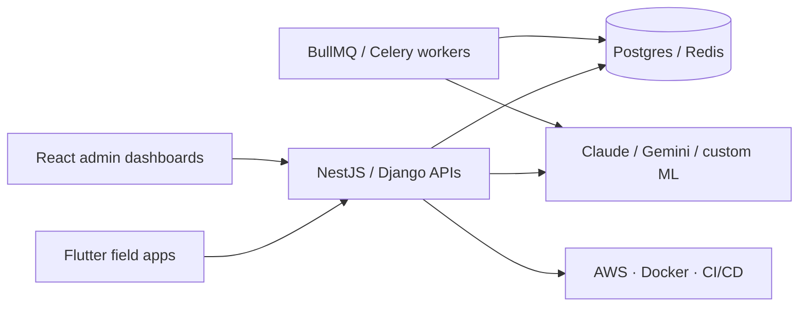

# Ahmed Mamdouh Eldarandaly

**Software Engineer @ [Genesis Infotech](https://github.com/eldarandaly)** · Building AI-powered products for retail, e-commerce, and industrial ops

[Portfolio](https://eldarandaly.ai) · [LinkedIn](https://linkedin.com/in/ahmed.eldarandaly) · [GitHub](https://github.com/eldarandaly)

---

## About me

I design and ship full-stack systems — from mobile and web frontends to APIs, workers, and cloud deployments. I care about clean architecture, strong typing, and products that hold up in production.

**Currently focused on**

- **Smart Shelf Intelligence** — multi-tenant FMCG shelf monitoring with Claude Vision, NestJS, React, and Flutter
- **[Armaarmy](https://armaarmy.com)** — wholesaler e-commerce platform
- **Industrial dashboards & AI** — real-time MMS monitoring, notifications, and chat assistants

**Ask me about:** Python · React · Flutter · NestJS · DevOps · AI integration

---

## Featured work

| Project | Stack | Description |
|---|---|---|
| [**shelf_scan**](https://github.com/eldarandaly/shelf_scan) | NestJS · React · Postgres · Redis · Claude | AI shelf scanning platform — 4-pass vision pipeline, analytics, visit reports |
| [**shelf_scan_flutter**](https://github.com/eldarandaly/shelf_scan_flutter) | Flutter · Dart | Field rep mobile app for in-store capture and visit workflows |
| [**MMS dashboards**](https://github.com/eldarandaly/MMS_multi_machine_dashboard) | React · Node · Python | Multi-machine monitoring dashboards with AI-assisted insights |
| [**shopify-bundle-app**](https://github.com/eldarandaly/shopify-bundle-app) | TypeScript · Shopify | Bundle and merchandising tooling for e-commerce |
| [**sales_team_crm**](https://github.com/eldarandaly/sales_team_crm) | TypeScript · React | Internal CRM for sales team operations |

More projects on my [portfolio](https://eldarandaly.ai) and [GitHub profile](https://github.com/eldarandaly?tab=repositories).

---

## What I'm building lately

---

## Tech stack

**Languages**  

**Frontend & mobile**  

**Backend & data**  

**Cloud & tooling**  

---

## GitHub stats

---

## Connect

---

*"First, solve the problem. Then, write the code." — John Johnson*

