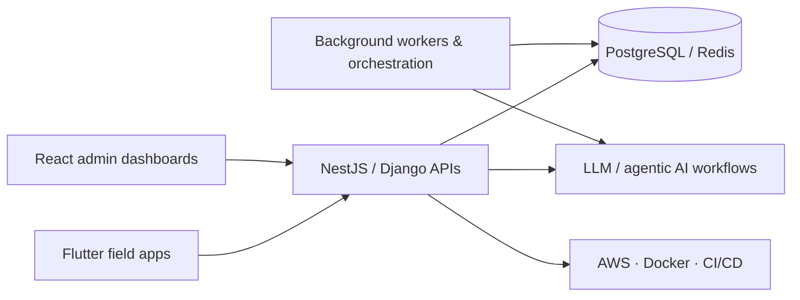

# Ahmed Mamdouh Eldarandaly

<strong>Software Engineer</strong> • Building AI-powered products for retail, e-commerce, and industrial operations

[Portfolio](https://eldarandaly.ai) · [LinkedIn](https://linkedin.com/in/ahmed.eldarandaly) · [GitHub](https://github.com/eldarandaly)

---

## About this repository

This repository is my public portfolio and profile hub. It showcases the systems I build, the products I help shape, and the technologies I use to bring ideas from concept to production.

---

## About me

I design and build full-stack systems across web, mobile, backend APIs, and cloud platforms. My work focuses on turning business needs into reliable digital products with strong architecture, clean engineering practices, and real-world operational value.

I enjoy building tools for retail intelligence, business automation, data-driven dashboards, and AI-assisted workflows.

### Currently focused on

- Smart Shelf Intelligence — AI-powered retail monitoring and operational insights
- Agentic AI products — LLM-based assistants, workflow orchestration, and decision-support systems
- E-commerce and merchandising systems — workflows, customer experiences, and product tooling
- Industrial dashboards and monitoring — machine insights, reporting, and operational visibility
- AI-powered business automation — integrating product logic with data and decision support

### I work with

Python · React · Flutter · NestJS · Django · DevOps · AI integration · Agentic workflows · Cloud architecture

---

## Featured public projects

| Project | Stack | Description |
|---|---|---|
| [**MMS dashboards**](https://github.com/eldarandaly/MMS_multi_machine_dashboard) | React · Node.js · Python · AI workflows | Industrial monitoring dashboards with AI-assisted insights, decision support, and operational visibility |
| [**shelf_scan**](https://github.com/eldarandaly/shelf_scan) | NestJS · React · PostgreSQL · Redis · Claude | AI shelf scanning platform for retail intelligence and operational analytics |
| [**shelf_scan_flutter**](https://github.com/eldarandaly/shelf_scan_flutter) | Flutter · Dart | Mobile field app for in-store capture and visit workflows |
| [**GymBro_Application**](https://github.com/eldarandaly/GymBro_Application) | Flutter · Dart | Fitness and workout application focused on user productivity and training tracking |
| [**Tele_Health_Mobile**](https://github.com/eldarandaly/Tele_Health_Mobile) | Flutter · Mobile · Healthcare | Mobile health platform for patient support and remote care workflows |
| [**Employees-HR-SYSTEM-2022**](https://github.com/eldarandaly/Employees-HR-SYSTEM-2022) | C# · .NET · Database | HR and employee management system with operational workflow support |
| [**IBM-Data-Science**](https://github.com/eldarandaly/IBM-Data-Science) | Python · Data Science · ML | Learning and project work covering analytics, modeling, and machine learning |

More projects are available on my [GitHub profile](https://github.com/eldarandaly?tab=repositories).

---

## Professional experience

I have worked across product engineering, internal business systems, and operational software, with a strong focus on building solutions that improve workflows, visibility, and decision-making.

At Genesis Infotech, I contributed to private internal systems across several domains, including:

- retail and store operations
- attendance and workforce management
- CRM and customer-facing workflows
- real-estate and sales platforms
- mobile and web business applications
- monitoring dashboards and operational tools
- AI-powered assistants and agentic workflow tooling

These experiences strengthened my ability to design practical systems that support real business needs, not just code quality in isolation.

---

## What I'm building lately

---

## Tech stack

### Languages

### Frontend & mobile

### Backend & data

### AI & automation

### Cloud & tooling

---

## GitHub stats

---

## Other public projects

- [ApiToolCSharp](https://github.com/eldarandaly/ApiToolCSharp)
- [BackGammon-With-Unity-](https://github.com/eldarandaly/BackGammon-With-Unity-)
- [HR-app-darandalyEdits](https://github.com/eldarandaly/HR-app-darandalyEdits)
- [Project-1](https://github.com/eldarandaly/Project-1)
- [Project2-Knn-Model-](https://github.com/eldarandaly/Project2-Knn-Model-)
- [Testing](https://github.com/eldarandaly/Testing)
- [ThreadsAdded-AccessControlThreads](https://github.com/eldarandaly/ThreadsAdded-AccessControlThreads)
- [Updated-Senior-Project-Final](https://github.com/eldarandaly/Updated-Senior-Project-Final)

---

## Connect

---

> "First, solve the problem. Then, write the code." — John Johnson

